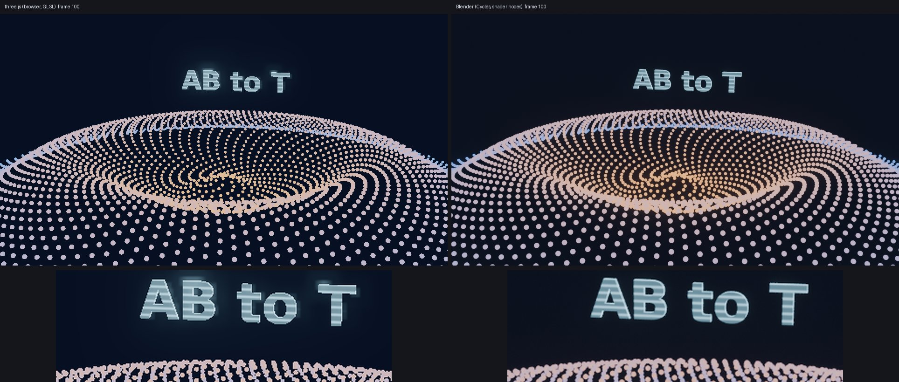

# AB to T

**让 AI 生成的 three.js 动画，能在 Blender 里一个参数一个参数地调。**

*AI writes a scene JSON instead of three.js code. It plays in the browser with three.js and imports into Blender as native, fully tweakable data — keyframes with Bézier handles, Geometry Nodes, shader nodes — and every tweak syncs back live.*



<sub>同一份场景 JSON 的第 100 帧：左边是浏览器里的 three.js（GLSL），右边是导入 Blender 后用 Cycles 渲染；下排是标题的全息代码材质放大。</sub>

## 为什么

让 AI 写 three.js 动画很快，但写出来的是代码：数值写死在代码里，想改就只能再让 AI 改。导进 Blender 也只剩烘焙好的结果，调不了。

AB to T 换了个做法：**AI 不写代码，写一份场景描述（JSON）**。程序化效果和代码材质封装成“组件”，同一个公式各实现一份 three.js 版和 Blender 版，参数从同一份说明生成。所以：

- 浏览器里看到的，和导入 Blender 后看到的，是同一个东西；
- 导入后每个参数都是 Blender 里的滑块，能打关键帧；
- 在 Blender 里调，浏览器一秒左右跟着刷新；
- AI 之后再改，是在 Blender 里做增量修改，不会冲掉你的手调。

```
            写场景 JSON（按 skill 里的规范）
 AI ───────────────────────────────────────►  scenes/shot.json
                                                │        ▲
                           three.js 播放 ◄──────┤        │ 实时写回
                                                ▼        │
                                     Blender 插件导入 ──► 原生对象 / 关键帧 / 节点
                                                         （你在这里手调）
```

## 能做到什么

- **物体、相机、灯光、文字**：位置、缩放、焦距、光照、字高，以及它们的关键帧（贝塞尔手柄两边一致）。
- **程序化效果组件**：比如自带的 `dot-galaxy`（螺旋点阵 + 波纹）、`voxel-wave`（体素柱随波纹起伏、从中心长出），在 Blender 里是 Geometry Nodes，参数在修改器面板里。两边按同一个公式算，体素逐块一致。
- **代码材质组件**：比如自带的 `holo`（全息扫描线 + 菲涅尔边缘光 + 闪烁），浏览器里是 GLSL，Blender 里是着色器节点，参数在材质面板里。
- **统一的显示标准**：Y 向上、米制、场景线性颜色，字号按大写 H 的实际高度对齐。浏览器里的色调映射用 Blender 自带的 AgX 表逐步算，像素滤镜、太阳光阴影也和 Blender 对齐，同一帧两边平均每像素只差 1–2/255。
- **实时同步**：Blender 里一改就写回 JSON，浏览器自动刷新。
- **省 token**：skill 平时只占约 50 token，用到时才加载；同步全是程序在跑，不经过 AI。

## 快速开始

需要 **Blender 4.2 及以上**（实测过 4.2 LTS、4.5 LTS、5.2；4.0、4.1 没有扩展机制，装不了），以及 Chrome 或 Edge（three.js 从 CDN 加载，需要联网）。插件、播放器和 skill 都不分系统，Windows、Mac、Linux 通用。

1. 下载本仓库（Code → Download ZIP，或 `git clone https://github.com/xie-hou/abt.git`）。
2. 安装 Blender 插件，推荐用更新源装，以后有新版本 Blender 会自动提示：
   - Blender → 编辑 → 偏好设置 → **系统 → 网络** 勾选「允许联网」；
   - **获取扩展** → 右上角「仓库」下拉 → **＋ → 添加远程仓库**，URL 填 `https://github.com/xie-hou/abt/releases/latest/download/index.json`，勾选「启动时检查更新」；
   - 在获取扩展里搜索 **AB to T** → 安装。

   不想联网也可以从 [Releases](https://github.com/xie-hou/abt/releases) 下载 `abt-<版本>.zip`，在获取扩展 → 右上角 ⌄ → **从磁盘安装…**（这样装的不会自动更新）。已经从磁盘装过的，插件设置里有「添加更新源」按钮：点一下，再卸载旧的、从「AB to T」仓库重装一次即可。
3. 把 `scenes/shot02.json`（示例镜头；`shot03.json` 演示旋转和图片，`shot04.json` 演示体素）从文件夹**拖进 Blender 的 3D 视图**，就会导入：生成 `scenes/shot02.blend` 并开启实时同步。
   也可以按 **N** 打开侧边栏，在 **AB to T** 标签里点 **导入场景 JSON** 选文件。
4. 侧边栏里点 **打开浏览器预览**：插件自带本机预览服务器，不用另装任何东西。
5. 选中 `fx_galaxy` 在修改器面板里调参数，或选中标题在材质面板里调全息效果，看浏览器跟着变。

## 用 AI 生成镜头

规范和工作流程打包成了一个 skill：[`skills/abt-scene`](skills/abt-scene/)。

### Claude Code

```
/plugin marketplace add xie-hou/abt
/plugin install abt@abt
```

（Claude Code 2.1.275 及以上也可以一步装好：`/plugin install abt --marketplace xie-hou/abt`）

装好后直接描述想要的镜头，比如：

> 做一个 shot04：5 秒，暗色背景，金色粒子漩涡慢慢展开，相机从高处推近，标题 NEW YEAR 在第 2 秒翻转着立起来

AI 会写 `scenes/shot04.json`，用检查脚本自查到通过，再告诉你怎么导入。现有组件做不出的效果，它会新建组件（three.js 版 + Blender 版）。

想让 AI 直接操作 Blender（导入、在 Blender 里改参数）：在插件设置里勾选 **允许 AI 控制 Blender**，并安装 Python 3。这个开关只监听本机 127.0.0.1，但能执行任意代码，不用时关掉。

### 其他支持 skill 的 AI 工具

skill 就是一个文件夹（`SKILL.md` + 规范 + 脚本）。让 AI 把 <https://github.com/xie-hou/abt/tree/main/skills/abt-scene> 下载到它的 skills 目录即可，比如 Claude Code 的 `~/.claude/skills/abt-scene/`。网页版 Claude 可以在设置里上传 Releases 里的 `abt-scene-skill.zip`。

### FRAME Studio

在 FRAME 的「技能」里上传 Releases 里的 `abt-scene-skill.zip`，之后在作品里让 AI 用 abt-scene 做镜头即可：
- 第一次用时，AI 会在作品库里建一个 `abt` 素材库，FRAME 服务器从 GitHub 下载固定版本的播放核心、组件和字体放进去（AI 只调用一次，不用抄文件内容；服务器要能访问 raw.githubusercontent.com）。所有作品共用、按版本锁定。
- 每个镜头是作品里的一个 three 场景图层（`abt/<镜头>.json` + 几行的 `scenes/abt-<镜头>.ts`），FRAME 的播放器照常实时预览，能和其他图层叠加、在时间轴上拖动，导出走 FRAME 原来的流程。
- 不用这个 skill 的作品完全不受影响。
- 镜头可以在你电脑上的 Blender 里手调，实时写回作品，FRAME 预览跟着刷新；FRAME 在服务器上也行。在 FRAME 作品的「Blender」选项卡（「素材」视图顶部的立方体按钮）点「复制连接码」，到 Blender 侧边栏 **AB to T → 连接 FRAME…** 粘贴。之后 FRAME 的 AI 能在这个 Blender 里打开镜头、改参数、用你电脑的显卡截图和渲染；你也能在「Blender」选项卡或资源管理器（右键镜头文件）里打开镜头。插件不开端口，是它主动连 FRAME；镜头和用到的组件、字体、图片在这台电脑上放一份，.blend 只留在这台电脑上。连着时 FRAME 那个作品库的 AI 能在 Blender 里执行代码，不用时在面板里把「连接 FRAME」关掉。

### 任意聊天 AI（ChatGPT 等）

1. 打开 [`PROMPT.md`](PROMPT.md)，把分隔线以下的内容整段复制给 AI，在最后写上你想要的镜头。
2. 把 AI 回复的 JSON 存成 `scenes/<名字>.json`（名字和 JSON 里的 `meta.name` 一致）。
3. 检查：`python skills/abt-scene/scripts/validate.py scenes/<名字>.json`，有错误就原样贴回给 AI 让它改。
4. 把 JSON 拖进 Blender 的 3D 视图导入。

聊天 AI 写不了文件，只能用现有组件，不能新建效果。

## 规范速览

完整规范：[`skills/abt-scene/references/spec.md`](skills/abt-scene/references/spec.md)

```json
{
  "spec": "abt-scene/0.1",
  "meta": {"name": "shot03", "fps": 24, "frames": [1, 120], "resolution": [1920, 1080]},
  "materials": {"mat_title": {"component": "holo@1", "params": {"color": [1.0, 0.5, 0.2]}}},
  "objects": [
    {"id": "cam_target", "type": "empty", "position": [0, 0.6, 0]},
    {"id": "cam_main", "type": "camera", "lens": 35, "position": [0, 4, 12], "target": "cam_target"},
    {"id": "fx_galaxy", "type": "component", "component": "dot-galaxy@1", "params": {"radius": 5}},
    {"id": "txt_title", "type": "text", "text": "HELLO", "font": "assets/fonts/DejaVuSans-Bold.ttf",
     "size": 0.5, "material": "mat_title", "position": [0, 1.5, -1]},
    {"id": "img_logo", "type": "image", "src": "assets/images/abt-logo.png", "height": 1, "position": [0, 2.8, -2]}
  ],
  "animation": [
    {"target": "cam_main", "path": "position", "keys": [{"f": 1, "v": [0, 4, 12]}, {"f": 120, "v": [2, 2, 8], "ease": "out"}]},
    {"target": "fx_galaxy", "path": "params.amplitude", "keys": [{"f": 1, "v": 0}, {"f": 48, "v": 0.5}]},
    {"target": "txt_title", "path": "rotation.x", "keys": [{"f": 30, "v": -90, "ease": "out"}, {"f": 60, "v": 0}]},
    {"target": "img_logo", "path": "opacity", "keys": [{"f": 60, "v": 0}, {"f": 84, "v": 1}]}
  ]
}
```

## 日常使用

- **导入**：把场景 JSON 拖进 3D 视图（或侧边栏“导入场景 JSON”）。会覆盖未保存的修改或已有的 .blend 时，会先弹确认框。
- **继续调**：以后直接打开 `scenes/<镜头>.blend`，实时同步会自动开启（插件设置里可以关）。**不要再导入同一个 JSON**，那样会冲掉在 Blender 里的手调。
- **AI 接着改**：继续跟 AI 说，它在 Blender 里做增量修改，改动同样实时写回。

## 在 Blender 里能调、会同步的

| 在 Blender 里 | 同步到浏览器 |
|---|---|
| 物体位置、旋转、缩放和它们的关键帧（含贝塞尔手柄） | ✓ |
| 相机焦距、目标点（删掉约束就改用旋转）；太阳光强度、颜色、方向 | ✓ |
| 图片的不透明度、亮度和它们的关键帧（侧边栏 AB to T 面板，或物体属性 → 自定义属性） | ✓ |
| 效果组件参数和关键帧（修改器面板） | ✓ |
| 代码材质参数和关键帧（材质面板） | ✓ |
| 普通材质的颜色、粗糙度、金属度、自发光；世界背景；辉光 | ✓ |
| 文字内容、字高、厚度 | ✓ |
| 新加的物体、换图片、其他灯光类型、Blender 独有的效果 | 保留在 Blender，暂不同步 |

## 写新组件

每个组件一个文件夹 `components/<名>/`：

- `component.json`：参数说明（类型、默认值、范围），两边共用；
- `three.js`：浏览器实现（物体组件导出 `create()`，材质组件导出 `createMaterial()`）；
- `blender.py`：Blender 实现（Geometry Nodes 或着色器节点），参数接口由插件按 `component.json` 自动生成。

两边必须是同一个公式，画面只由（时间, 参数）决定，不用随机数和系统时钟。噪声类效果两边的噪声算法不同，要么避开，要么两边用同一份实现。详见规范末尾“新建组件”。

## 已知限制和计划

- 暂不支持太阳光以外的灯光、视频素材、父子层级、在 Blender 里新加的物体。
- 旋转在 Blender 里用 YZX（文字、相机用 ZYX）欧拉模式，这样各通道和 three.js 一一对应。手动改了旋转模式时，静态朝向照常写回，旋转动画不再写回。
- 辉光两边算法不同，只能近似。Blender 4.2 的辉光节点没有“强度”，插件按校准过的比例换算，画面和 5.x 基本一致。
- 环境光遮蔽：EEVEE 会让缝隙、角落略暗一点，浏览器里没有；挤出文字的侧面明暗也有细微差别。
- 计划：After Effects 端（相机和空物体导出、多层 EXR 渲染通道）、噪声函数库、更多组件。

## 仓库结构

```
skills/abt-scene/   skill：SKILL.md、references/spec.md（规范）、scripts/（检查、生成提示词、操作 Blender）
blender/abt/        Blender 扩展源码
components/         效果组件
web/                three.js 播放核心（abt-engine.js）和浏览器预览
frame/              FRAME Studio 的场景图层接口和素材库说明
vendor/             opentype.js（字体解析，MIT）
scenes/             场景 JSON（.blend 不进版本库）
assets/fonts/       字体
assets/images/      图片
PROMPT.md           给聊天 AI 的提示词（自动生成）
.claude-plugin/     Claude Code 插件市场清单
tools/package.py    打包 Blender 插件和 skill
```

## 开发

- 打包：`python tools/package.py`（需要 Python 3.11+），生成 `dist/abt-<版本>.zip`、`dist/abt-scene-skill.zip`、`dist/frame-install.json`（在 FRAME 里装素材库的操作，文件从标签 `v<版本>` 下载）、`dist/index.json`（Blender 更新源的清单）和 `dist/frame-library/`（装好后的素材库，测试用），同时重新生成 `PROMPT.md`。
- 发布：升版本号（`blender/abt/blender_manifest.toml` 和 `.claude-plugin/plugin.json`）→ 提交 → 打标签 `v<版本>` 并推送 → 打包 → 上传 Releases（`abt-<版本>.zip`、`abt-scene-skill.zip`、`frame-install.json`、`index.json` 四个都要传，少了 `index.json` 更新源就查不到新版）。先打包再打标签的话，FRAME 会装到别的版本。
- `web/agx-lut.js` 由 `python tools/make_agx_lut.py <Blender>/<版本>/datafiles/colormanagement` 从 Blender 自带的 AgX 表生成，Blender 换了 AgX 时才需要重新生成。
- 检查插件清单：`claude plugin validate .`
- 改了 Blender 插件代码后重启 Blender 生效（只改了子模块时，停用再启用插件不会重新加载）。
- 版本兼容：和 Blender 版本有关的写法（修改器参数、合成器、动画曲线、EEVEE 名字、EXR 输出）都在 `blender/abt/core.py` 里按版本分支处理，改动后要在 4.2、4.5、5.x 上各跑一遍导入和写回。

## 许可证

本项目以 [GPL-3.0-or-later](LICENSE) 发布：可以自由使用、修改和再发布（包括商用），但再发布修改版或包含本项目代码的作品时，也必须以 GPL 开源并附上源码。

`web/agx-lut.js` 里的 AgX 色彩表取自 Blender 自带的色彩管理配置（随 Blender 以 GPL 发布）。`vendor/opentype.min.mjs`（opentype.js 2.0.0）使用 MIT 许可，见 [`vendor/LICENSE-opentype.txt`](vendor/LICENSE-opentype.txt)。`assets/fonts/` 里的 DejaVu 字体使用它自己的许可，见 [`assets/fonts/LICENSE-DejaVu.txt`](assets/fonts/LICENSE-DejaVu.txt)。
